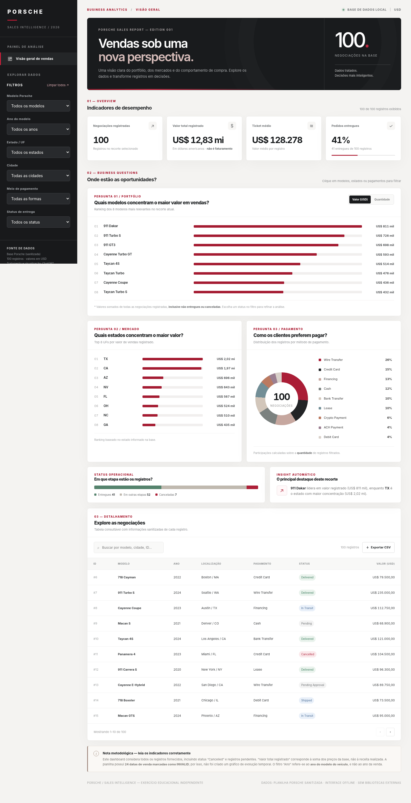
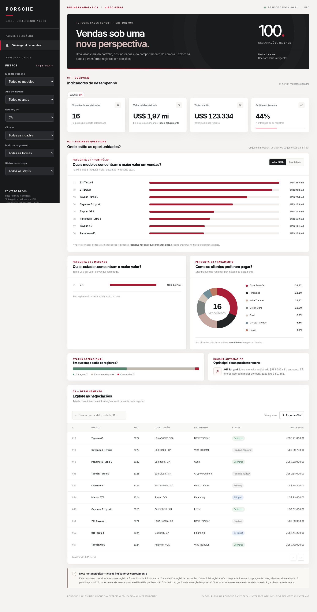
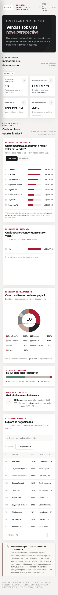

# Porsche | Sales Intelligence

Dashboard interativo em **HTML de arquivo único**, construído a partir da planilha sanitizada do desafio, com **100 registros**. Não depende de internet, banco de dados, instalação nem bibliotecas externas para funcionar.

## Acessar o painel

- **Dashboard publicado:** `COLE_AQUI_O_LINK_DO_GITHUB_PAGES_APOS_PUBLICAR`
- **Arquivo para executar:** [`index.html`](index.html) — basta abrir em qualquer navegador atual.
- **Base para conferência:** [`dados_sanitizados.csv`](dados_sanitizados.csv) — campos sanitizados utilizados pelo painel. O CSV não é necessário para que o HTML funcione.
- **Evidências visuais:** confira os arquivos de imagem `evidencia-dashboard.png` e `evidencia-filtro.png`, caso presentes.

## Evidências da dashboard funcionando

**Tela inicial — 100 registros, KPIs e gráficos:**



**Exemplo de filtro aplicado — estado CA (16 registros):**



**Teste de responsividade no celular:**



## Três perguntas de negócio e por que foram escolhidas

1. **Quais modelos concentram o maior valor em vendas?** A comparação do valor registrado por modelo evidencia o mix do portfólio e os veículos que mais contribuem para o total negociado. O gráfico permite alternar entre **valor em USD** e **quantidade de registros**.
2. **Quais estados concentram o maior valor?** A distribuição geográfica permite identificar mercados em destaque e ajudar na priorização de estratégias comerciais. O ranking considera a **UF do registro**.
3. **Como os clientes preferem pagar?** A participação de cada meio de pagamento mostra o comportamento de compra e ajuda a entender quais modalidades aparecem com mais frequência. O gráfico de rosca usa **quantidade de registros**, e não receita.

Além dessas perguntas, o painel apresenta quatro indicadores (quantidade de negociações, valor total registrado, ticket médio e percentual entregue), situação operacional das entregas, insight contextual, tabela paginada e exportação CSV.

## Prompt utilizado para desenvolver o dashboard

> Tenho uma planilha Excel com 100 registros sanitizados de vendas Porsche, com modelo, ano do veículo, preço em USD, cidade, estado, meio de pagamento, status de entrega, quilometragem e data sanitizada. Crie um dashboard profissional, **em um único arquivo `index.html`**, com HTML, CSS e JavaScript embutidos, sem dependências externas, inspirado em uma estética automotiva premium (preto, branco e vermelho). Ele deve responder a três perguntas de negócio: (1) quais modelos geram maior valor, (2) quais estados concentram o maior valor, e (3) quais formas de pagamento são mais utilizadas. Inclua filtros combináveis por modelo, ano do modelo, UF, cidade, pagamento e status, quatro indicadores no topo, tabela de detalhamento, exportação CSV e layout responsivo. Todos os indicadores e gráficos devem reagir aos filtros. Use apenas campos sanitizados. Identifique limitações da qualidade dos dados sem inventar informações.

## Refinamentos até a versão final

- Ajustada a visualização para um **único HTML autossuficiente**, com dados embutidos e sem dependência de Excel ou bibliotecas de gráficos.
- Gráficos de ranking tornados **clicáveis para filtrar** a análise por modelo ou estado; a legenda do gráfico de pagamentos também filtra.
- Adicionados filtros de status, cidade e ano **do modelo**, botão de limpeza, busca textual na tabela e exportação das linhas filtradas para CSV.
- Incluída nota metodológica para diferenciar **valor de negócios registrados** de **receita efetivamente realizada**. Registros cancelados e pendentes seguem na base e podem ser isolados pelo filtro de status.
- Excluída uma análise temporal porque **24 das 100 datas sanitizadas estão marcadas como `INVALID`**. Isso evita conclusões incorretas sobre sazonalidade.
- Validado o total de **100 negociações**, **US$ 12.827.800,50** em valor registrado e **41 entregues** na base completa.

## Tratamento da base antes de gerar o HTML

- Utilizada a aba `Sanitized` da planilha original, **somente colunas padronizadas** para modelo, ano, preço, quilometragem, pagamento, cidade, estado, status e data.
- Conversão de `SalesPriceSanitized` para **número decimal** (USD) e `ModelYearSanitized` para **inteiro**.
- Conversão da quilometragem sanitizada para inteiro; preservação das unidades em milhas conforme a base.
- Preservação de valores categóricos padronizados e dos identificadores de venda.
- Remoção de nomes de clientes, vendedores e campos brutos da versão publicada, pois **não são necessários** às perguntas escolhidas.
- Verificação de 100 identificadores únicos; nenhum valor de preço ausente; datas inválidas mantidas como marcação `INVALID` apenas para auditoria no CSV.

**Importante:** as informações incluem registros `Cancelled`, pendentes e em trânsito. O somatório de preços foi chamado de *valor total registrado*, e não *faturamento realizado*. O ano filtrado é o **ano do modelo**, não o ano da venda.

## Ferramenta e método

**ChatGPT em conversa direta**, com análise da planilha anexada e geração de código HTML/CSS/JavaScript. **Não foi utilizado Canvas nem agente customizado com skill**. O HTML foi montado e refinado especificamente para as três perguntas escolhidas.
├── dados_sanitizados.csv      # Conferência dos dados (opcional)
├── evidencia-dashboard.png   # Tela inicial, se capturada
└── evidencia-filtro.png       # Filtro de estado CA, se capturado
```

*Projeto acadêmico independente, não afiliado à Porsche AG. Nomes comerciais e dados mantidos exclusivamente no contexto do desafio.*
